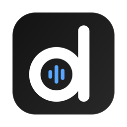
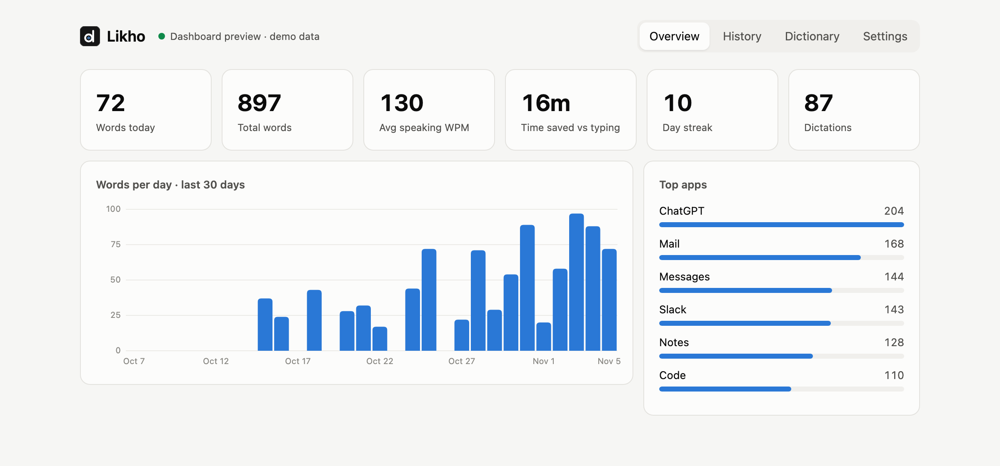

<p align="center"></p>
<h1 align="center">Likho</h1>
<p align="center"><b>Private voice dictation for Mac.</b> Hold a key, talk, let go — clean text is typed in any app.<br>
Speech recognition runs entirely on your Mac. Free and open source.</p>
<p align="center"><a href="https://saisharan1902.github.io/likho/">Website</a> · <a href="#install">Install</a> · <a href="#how-it-works">How it works</a></p>

<p align="center"></p>

## Features

- **Works everywhere you type** — Slack, Gmail, Notes, ChatGPT, VS Code, Terminal. No plugins.
- **On-device speech recognition** — NVIDIA Parakeet (English, fastest) or OpenAI Whisper (multilingual), running on Apple Silicon via [MLX](https://github.com/ml-explore/mlx).
- **Fast** — text appears ~0.5 s after you let go (M4, clean speech). Models are kept warm.
- **AI cleanup (optional)** — removes fillers, keeps only what you meant after "no wait…", formats spoken lists. Local with [Ollama](https://ollama.com), or bring your own key (Anthropic, OpenAI, Groq, OpenRouter, LM Studio, any OpenAI-compatible server).
- **Your vocabulary** — custom words fix the spelling of names and jargon; replacements turn "my email" into your address.
- **Dashboard** — words per day, speaking speed, time saved, searchable history. All local.
- **Private by default** — audio is never written to disk unless you enable recordings; the dashboard listens on `127.0.0.1` only.

## Install

Requirements: macOS 13+, Apple Silicon, Python 3.12 (`brew install python@3.12`), ~4 GB of disk for models.

```bash
git clone https://github.com/Saisharan1902/likho.git
cd likho
./run.sh                 # creates .venv, installs dependencies, downloads the speech model, starts Likho
```

Then allow your terminal app under **System Settings → Privacy & Security**: **Microphone**, **Input Monitoring** (to see the hotkey) and **Accessibility** (to type into other apps). Quit and restart it.

### As a menu-bar app

```bash
scripts/build_app.sh     # builds /Applications/Likho.app
```

Open **Likho** from Spotlight. Grant *Likho* the three permissions above, then quit and reopen it. Clicking the app opens the dashboard; it lives in the menu bar (no Dock icon). To start at login: System Settings → General → Login Items → **+** → Likho.

The app runs this folder's code, so changes apply on the next launch; rebuild only if you move the folder. Logs: `~/Library/Logs/Likho.log`.

### Optional: local AI cleanup

```bash
brew install ollama && brew services start ollama
ollama pull llama3.2:3b
```

Then turn it on in Dashboard → Settings → AI cleanup.

## Use

| Action | What happens |
|---|---|
| Hold **Right ⌥** and talk, release | Transcribes and types where your cursor is |
| Double-tap **Right ⌥** | Hands-free (red dot) — tap again to finish |
| **Esc** while recording | Cancel |
| Menu-bar icon → Open Dashboard | Stats, history, dictionary, settings |

The key can be changed to Fn, Right ⌘, Right ⌃ or Right ⇧ in Settings.

## AI cleanup

**Smart** mode (default) only calls the AI when the transcript has something to fix — fillers, self-corrections, repeated words, a spoken list — because speech models already punctuate. **Always** mode cleans every dictation of 4+ words.

If the AI is slow, down, or replies with something that isn't a cleanup (an answer, an essay), Likho types your raw words instead.

Local models on a MacBook Pro M4 (`scripts/bench_ai.py`, 10 tricky dictations):

| Model | Score | Avg time | Size |
|---|---|---|---|
| `gemma3:4b` | 10/10 | 1.3 s | 3.3 GB |
| `llama3.2:3b` (default) | 8/10 | 0.4 s | 2.0 GB |
| `qwen2.5:3b` | 8/10 | 0.4 s | 1.9 GB |

## How it works

```
hotkey (macos.py) → ptt.py → audio.py (mic, pre/post-roll) ─┐
                                                             ▼
   pipeline.py: prepare() → transcriber.py → replacements → llm.py (optional) → paste → db.py
                                                             │
overlay.py (pill + menu bar) ◀──────── state ────────────────┘   server.py + dashboard/ (127.0.0.1)
```

| File | Role |
|---|---|
| `likho/config.py` | Settings (`data/settings.json`), live-updated by the dashboard |
| `likho/db.py` | History + stats (`data/likho.db`) |
| `likho/audio.py` | Microphone capture, silence trimming, loudness normalisation |
| `likho/transcriber.py` | Parakeet / Whisper via MLX, dictionary correction, replacements |
| `likho/llm.py` | Optional AI cleanup: providers, prompt, reply guards |
| `likho/macos.py` | Global hotkey (Quartz event tap), paste, permissions, overlay window |
| `likho/ptt.py` | Hold / double-tap hands-free / cancel state machine |
| `likho/overlay.py` | Floating pill + menu-bar icon |
| `likho/window.py` | Dashboard window |
| `likho/server.py` | Dashboard API |
| `likho/pipeline.py` | Recording → text → typed → saved |
| `likho/app.py` | Wires it all together |
| `scripts/launcher.m` | Native launcher for Likho.app (so macOS permissions belong to Likho) |

## Development

```bash
.venv/bin/python -m pytest tests/ -v              # test suite
.venv/bin/python scripts/try_mic.py               # speak → text
.venv/bin/python scripts/try_hotkey.py            # hotkey + paste
.venv/bin/python scripts/try_overlay.py live      # pill follows your voice
.venv/bin/python scripts/try_dashboard.py demo    # dashboard with sample data
.venv/bin/python scripts/bench.py record|run      # speech models on your voice
.venv/bin/python scripts/bench_ai.py              # AI cleanup models
```

Your data lives in `data/` (git-ignored). `LIKHO_DATA_DIR` and `LIKHO_PORT` override the folder and dashboard port.

## License

[Apache License 2.0](LICENSE). The "Likho" name and logo are not covered by the license — forks must use their own (see [NOTICE](NOTICE)).
